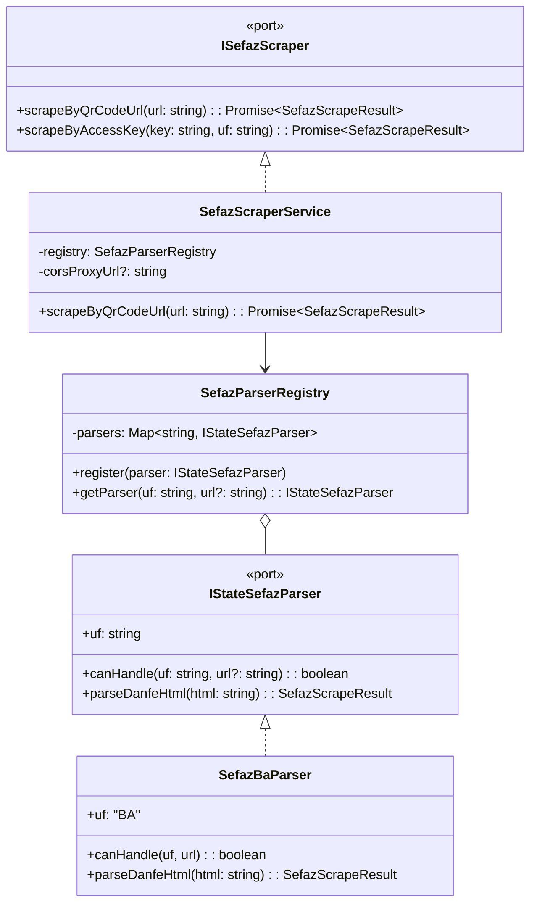

# 09 - Web Scraping SEFAZ por Estado & Validação de Destinatário

Este plano detalha a especificação técnica e arquitetural para implementar o **Web Scraping modular por estado da SEFAZ** (com foco inicial na SEFAZ-BA) e a **validação de conformidade do destinatário** (Consumidor) contra uma lista de CPFs/CNPJs autorizados previamente configurados.

---

## 🎯 1. Contexto e Objetivos

Ao escanear o QR Code de uma NFC-e (modelo 65) ou código de barras de NF-e (modelo 55), o parser matemático da chave de 44 dígitos extrai metadados estruturais (UF, AAMM, CNPJ do emitente, modelo, série e número). No entanto, **dados fiscais e operacionais críticos não estão codificados na chave** e precisam ser obtidos através do scraping do portal da SEFAZ estadual:

1. **Campos Faltantes Identificados**:
   - **Valor Total da Nota (`totalAmount`)**: Atualmente preenchido manualmente.
   - **Data e Hora Exata de Emissão (`emissionDate`)**: A chave possui apenas Ano/Mês (`AAMM`), enquanto a SEFAZ fornece o timestamp exato (`YYYY-MM-DDTHH:mm:ss-03:00`).
   - **Protocolo de Autorização (`protocol`)**: Registro de autenticidade fiscal.
   - **Itens e Produtos da Compra (`items`)**: Lista completa com descrição, código, quantidade, unidade, valor unitário e total.
   - **Forma de Pagamento (`paymentMethod`)**: Dinheiro, Cartão de Crédito/Débito, Pix, etc.
   - **Tributos Totais Incidentes (`taxAmount`)**: Valor de tributos federais e estaduais (Lei 12.741/2012).
   - **Endereço Completo do Emitente (`issuerAddress`)**: Logradouro, bairro, município e UF.
   - **Dados do Destinatário/Consumidor (`recipient`)**: CPF/CNPJ e Nome/Razão Social.

2. **Regra de Conformidade Fiscal da Igreja (Validação de Destinatário)**:
   - Em instituições religiosas e sem fins lucrativos, as despesas prestadas à tesouraria devem cumprir regras estritas de auditoria fiscal:
     - **Válido (Sem Identificação)**: Compras do dia a dia emitidas como "Consumidor não identificado".
     - **Válido (Destinatário Autorizado)**: Compras emitidas no CNPJ da Igreja (Matriz ou Filial) ou no CPF de voluntários/líderes autorizados (previamente cadastrados na tela de configurações).
     - **Inválido / Alerta de Auditoria**: Compras emitidas com CPF/CNPJ de terceiros não cadastrados, impedindo reembolso indevido ou sinalizando necessidade de retificação.

---

## 🔍 2. Análise Técnica do Caso Real: SEFAZ Bahia (BA)

A partir do exemplo real fornecido:
`http://nfe.sefaz.ba.gov.br/servicos/nfce/modulos/geral/NFCEC_consulta_chave_acesso.aspx?p=29260944053985000199650010000661511323710790|2|1|1|2F1810D1D732632EB9AD6CD9E2A9B703AB30085C`

### Comportamento do Servidor SEFAZ-BA (ASP.NET IIS):
1. A requisição inicial com o parâmetro `p=CHAVE|VERSAO|AMBIENTE|ID_CSC|HASH` retorna um redirecionamento HTTP 302 com cookie de sessão (`ASP.NET_SessionId`) para `/servicos/nfce/modulos/geral/NFCEC_consulta_danfe.aspx`.
2. Mantendo o cookie ou acessando a URL de consulta, a página do DANFE é renderizada com a seguinte estrutura DOM:

```html
<!-- Emitente -->
<div class="txtCenter">
  <div id="u20" class="txtTopo">NOLASCO &amp; SOUSA LTDA</div>
  <div class="text">CNPJ: 44.053.985/0001-99</div>
  <div class="text">AVENIDA BELA VISTA, S/N, , BATE PE, VITORIA DA CONQUISTA, BA</div>
</div>

<!-- Tabela de Itens -->
<table border="0" align="center" cellpadding="0" cellspacing="0" id="tabResult">
  <tr id="Item + 1">
    <td valign="top">
      <span class="txtTit">OLEO DIESEL B S500 COMUM</span>
      <span class="RCod">(Código: 6)</span>
      <br>
      <span class="Rqtd"><strong>Qtde.:</strong>49,444</span>
      <span class="RUN"><strong>UN: </strong>LITRO</span>
      <span class="RvlUnit"><strong>Vl. Unit.:</strong> 8,09</span>
    </td>
    <td align="right" valign="top" class="txtTit noWrap">
      Vl. Total<br><span class="valor">400,00</span>
    </td>
  </tr>
</table>

<!-- Totais e Pagamento -->
<div id="totalNota" class="txtRight">
  <div id="linhaTotal">
    <label>Qtd. total de itens:</label>
    <span class="totalNumb">1</span>
  </div>
  <div id="linhaTotal" class="linhaShade">
    <label>Valor a pagar R$:</label>
    <span class="totalNumb txtMax">400,00</span>
  </div>
  <div id="linhaTotal">
    <label class="tx">1 - Dinheiro</label>
    <span class="totalNumb">400,00</span>
  </div>
  <div id="linhaTotal" class="spcTop">
    <label class="txtObs">Informação dos Tributos Totais Incidentes ...</label>
    <span class="totalNumb txtObs">108,00</span>
  </div>
</div>

<!-- Informações Gerais & Protocolo -->
<div data-role="collapsible">
  <h4>Informações gerais da Nota</h4>
  <ul data-role="listview">
    <li>
      <strong>Número: </strong>66151
      <strong> Série: </strong>1
      <strong> Emissão: </strong>27/09/2026 07:37:06-03:00
      <br><br><strong>Protocolo de Autorização: </strong>229261255104844
    </li>
  </ul>
</div>

<!-- Destinatário / Consumidor -->
<div data-role="collapsible">
  <h4>Consumidor</h4>
  <ul data-role="listview">
    <li><strong>CNPJ: </strong>17.261.509/0007-86</li>
    <li><strong>Razão Social: </strong>Consumidor</li>
  </ul>
</div>
```

---

## 🏗️ 3. Arquitetura Modular Multi-Estado (Hexagonal)

Para garantir escalabilidade para todos os estados brasileiros sem acoplar a lógica à Bahia, adotamos o padrão **Registry / Strategy**:



### 3.1. Estrutura de Diretórios Proposta

```
src/
├── domain/
│   ├── entities/
│   │   ├── invoice.ts                  # Atualizado com novos campos (recipient, items, protocol)
│   │   ├── invoice-item.ts             # Nova entidade: itens comprados
│   │   └── church-settings.ts          # Nova entidade: configurações da igreja e CPFs autorizados
│   └── services/
│       └── recipient-validator.service.ts # Validação pura de conformidade do destinatário
├── ports/
│   ├── sefaz-scraper.port.ts           # Atualização do SefazScrapeResult
│   ├── state-sefaz-parser.port.ts      # Contrato IStateSefazParser
│   └── church-settings-repository.port.ts # Contrato de persistência das configurações
├── adapters/
│   ├── sefaz/
│   │   ├── parsers/
│   │   │   ├── sefaz-ba.parser.ts      # Parser especialista da SEFAZ Bahia
│   │   │   └── sefaz-parser-registry.ts # Registro e resolução por UF
│   │   └── sefaz-scraper.service.ts    # Orquestrador com suporte a proxy CORS e offline fallback
│   └── storage/
│       ├── db.ts                       # Migração do Dexie para v2 (tabela settings e items)
│       └── dexie-settings.repository.ts # Repositório local das configurações
├── stores/
│   ├── use-church-settings-store.ts    # Gerenciamento de estado das configurações
│   └── use-invoice-form-store.ts       # Integração do scraping automático e validação
├── components/
│   ├── settings/
│   │   └── settings-dialog.tsx         # Interface para gerenciar CNPJ da igreja e CPFs autorizados
│   └── invoices/
│       ├── recipient-status-badge.tsx  # Badge visual: Sem Identificação / Autorizado / Não Autorizado
│       └── invoice-items-table.tsx     # Tabela de itens da nota fiscal
```

---

## 🔒 4. Validação de Destinatário & Gestão de Configuração

### 4.1. Entidade de Configurações (`src/domain/entities/church-settings.ts`)
```typescript
export interface AuthorizedRecipient {
  id: string;
  name: string;
  cpfCnpj: string; // 11 dígitos (CPF) ou 14 dígitos (CNPJ)
  role: 'CHURCH_HEADQUARTERS' | 'CHURCH_BRANCH' | 'PASTOR' | 'TREASURER' | 'BUYER' | 'OTHER';
}

export interface ChurchSettings {
  id: string; // 'default'
  churchName: string;
  mainCnpj?: string;
  authorizedRecipients: AuthorizedRecipient[];
  corsProxyUrl?: string; // Proxy opcional configurável (padrão seguro)
  updatedAt: number;
}
```

### 4.2. Serviço de Validação de Domínio (`src/domain/services/recipient-validator.service.ts`)
```typescript
export type RecipientValidationStatus = 'UNIDENTIFIED' | 'AUTHORIZED' | 'UNAUTHORIZED';

export interface RecipientValidationResult {
  status: RecipientValidationStatus;
  message: string;
  matchedRecipient?: AuthorizedRecipient;
}

export function validateRecipient(
  recipientCpfCnpj: string | undefined,
  authorizedRecipients: AuthorizedRecipient[],
  churchMainCnpj?: string
): RecipientValidationResult {
  const clean = recipientCpfCnpj ? recipientCpfCnpj.replace(/\D/g, '') : '';

  // 1. Sem identificação no cupom fiscal (Válido para prestação de contas)
  if (!clean) {
    return {
      status: 'UNIDENTIFIED',
      message: 'Consumidor não identificado no cupom fiscal (Conforme para prestação de contas).',
    };
  }

  // 2. Compara com o CNPJ principal da igreja
  if (churchMainCnpj && clean === churchMainCnpj.replace(/\D/g, '')) {
    return {
      status: 'AUTHORIZED',
      message: 'Emitido no CNPJ oficial da Igreja Matriz.',
    };
  }

  // 3. Compara com a lista de autorizados cadastrados
  const match = authorizedRecipients.find(
    (item) => item.cpfCnpj.replace(/\D/g, '') === clean
  );

  if (match) {
    return {
      status: 'AUTHORIZED',
      message: `Emitido para destinatário autorizado: ${match.name} (${match.role}).`,
      matchedRecipient: match,
    };
  }

  // 4. Identificado, porém NÃO cadastrado na lista da Igreja (Alerta de Auditoria)
  return {
    status: 'UNAUTHORIZED',
    message: `Atenção: Destinatário com CPF/CNPJ (${recipientCpfCnpj}) não cadastrado na lista de autorizados da igreja.`,
  };
}
```

---

## 🌐 5. Desafio de CORS no PWA & Estratégia de Scraping Resiliente

Em aplicações PWA cliente (browser), servidores de SEFAZ estaduais não retornam cabeçalhos `Access-Control-Allow-Origin: *`.

### Estratégia em Três Níveis (Resiliência Total):
1. **Scraping Automático via Proxy CORS Transparente**:
   - Utilização de proxy CORS (ex: Cloudflare Worker dedicado ou serviço público como `https://api.allorigins.win/raw?url=`).
   - Possibilidade de configurar a URL do proxy na tela de configurações da aplicação.
2. **Fallback Gracioso para Inserção Manual / Colar HTML**:
   - Se o scraping falhar ou estiver sem rede, a aplicação não trava e não impede o salvamento.
   - O usuário pode preencher o valor manualmente (como já funciona hoje) ou colar o código HTML da SEFAZ para processamento instantâneo no cliente.
3. **Botão "Consultar SEFAZ" Sob Demanda**:
   - Disponível no diálogo de detalhes da nota caso a nota tenha sido cadastrada offline (`sefazDataStatus === 'PENDING'`). Ao recuperar a conexão, o usuário clica em "Atualizar dados da SEFAZ" e os itens/valores são preenchidos retroativamente.

---

## 🧪 6. Plano de Testes & Verificação

1. **Testes Unitários do Parser SEFAZ-BA (`tests/unit/sefaz-ba-parser.test.ts`)**:
   - Testar o HTML real da Bahia obtido na requisição com sessão.
   - Validar extração de:
     - Valor total: `400.00`
     - Data de emissão: `2026-09-27T07:37:06-03:00`
     - Destinatário CNPJ: `17.261.509/0007-86`
     - Protocolo: `229261255104844`
     - Itens: 1 item com `OLEO DIESEL B S500 COMUM`, qtd `49.444`, unit `LITRO`, unitPrice `8.09`, total `400.00`.
   - Testar variações: consumidor sem identificação, múltiplos itens, descontos.
2. **Testes Unitários do Validador de Destinatário (`tests/unit/recipient-validator.test.ts`)**:
   - Caso sem CPF/CNPJ -> `UNIDENTIFIED`.
   - Caso com CNPJ da Matriz -> `AUTHORIZED`.
   - Caso com CPF de líder cadastrado -> `AUTHORIZED`.
   - Caso com CPF desconhecido -> `UNAUTHORIZED`.
3. **Testes de Integração com IndexedDB (`tests/unit/settings-storage.test.ts`)**:
   - Salvar, consultar e atualizar lista de autorizados no Dexie.
4. **Execução de Verificação**:
   ```bash
   npm run test
   npm run lint
   ```

---

## 📅 7. Etapas de Execução

- **Etapa 1: Domínio e Contratos**:
  - Criação de `invoice-item.ts`, `church-settings.ts`, atualização de `invoice.ts`.
  - Implementação de `recipient-validator.service.ts` com testes unitários.
- **Etapa 2: Implementação do Parser SEFAZ-BA & Registry**:
  - `IStateSefazParser`, `SefazBaParser`, `SefazParserRegistry`.
  - Testes com fixture do HTML real da Bahia.
- **Etapa 3: Repositório Dexie & Migração v2**:
  - Criação de tabela `settings` e campo `items` / `recipient` em `invoices`.
- **Etapa 4: Tela de Configurações**:
  - Componente `SettingsDialog` / aba para gerenciar dados da igreja e lista de CPFs/CNPJs autorizados.
- **Etapa 5: Integração no Fluxo de Nova Nota & Detalhes**:
  - Scraping automático após leitura do QR Code.
  - Exibição de itens e badge de validação de destinatário.
