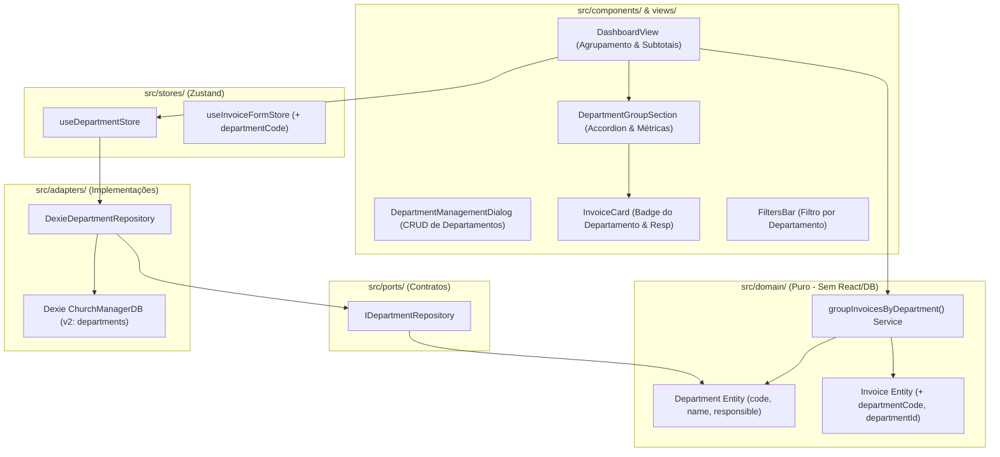

# 10 - Gestão de Departamentos & Agrupamento de Notas Fiscais

Este plano detalha a especificação técnica e arquitetural para implementar o **cadastro e gestão de departamentos/centros de custo** (código, nome e responsável) e o **agrupamento e filtragem de notas fiscais por departamento** no painel do Church Manager.

---

## 🎯 1. Contexto e Objetivos

Uma igreja organiza suas atividades e prestação de contas por ministérios e setores operacionais (Ex: Ministério Infantil, Louvor, Patrimônio, Ação Social, Missões, Administração). 

Atualmente, todas as notas fiscais cadastradas no Church Manager ficam em uma lista linear no dashboard, sem diferenciação do departamento que originou a compra.

### Objetivos Principais:
1. **Entidade de Departamento**: Cadastro estruturado de departamentos com `code` (código identificador único, ex: `INF-01`, `LOUV`), `name` (nome oficial, ex: `Ministério Infantil`) e `responsible` (nome do líder ou responsável pelas compras).
2. **Vinculação de Notas**: Possibilidade de selecionar o departamento responsável tanto no momento do cadastro da nota (`InvoiceForm`) quanto na edição posterior (`EditInvoiceDialog`).
3. **Agrupamento Inteligente no Dashboard**:
   - Alternador de visualização: **Lista Corrida** vs. **Agrupado por Departamento**.
   - Seções visuais para cada departamento contendo:
     - Nome e código do departamento.
     - Nome do responsável (`Resp: Mariana Silva`).
     - Contador de notas fiscais vinculadas.
     - **Subtotal financeiro acumulado (R$)** gasto pelo departamento.
     - Lista expansível/retrátil das notas vinculadas.
     - Seção dedicada para notas *"Sem Departamento / Não Atribuído"*.
4. **Filtro por Departamento**: Filtro rápido na barra de buscas para isolar notas de um setor específico.
5. **Carga Inicial Pré-configurada (Seed Offline)**: Carga inicial com departamentos comuns de igrejas para facilitar o uso imediato pelo voluntário ou tesoureiro.

---

## 🏗️ 2. Arquitetura do Sistema (Hexagonal / Ports & Adapters)

Mantendo a separação estrita de camadas e a regra de ouro de domínio puro:



---

## 📋 3. Especificação das Camadas

### 3.1. Núcleo Puro de Domínio (`src/domain/`)

#### Entidade de Departamento (`src/domain/entities/department.ts`)
```typescript
export interface Department {
  id: string; // Identificador único (UUID)
  code: string; // Código alfanumérico curto único (ex: 'INF', 'LOUV', 'ADM', 'MIS')
  name: string; // Nome do departamento (ex: 'Ministério Infantil')
  responsible: string; // Nome da pessoa responsável (ex: 'Mariana Silva')
  description?: string;
  createdAt: number; // Unix timestamp em ms
  updatedAt: number; // Unix timestamp em ms
}
```

#### Atualização da Entidade `Invoice` (`src/domain/entities/invoice.ts`)
```typescript
export interface Invoice {
  // ... campos existentes
  departmentId?: string; // ID do departamento vinculado
  departmentCode?: string; // Código denormalizado para consultas rápidas
  departmentName?: string; // Nome denormalizado para exibição
}
```

#### Serviço Puro de Agrupamento (`src/domain/services/department-grouping.service.ts`)
```typescript
export interface DepartmentGroup {
  departmentId?: string;
  departmentCode: string; // 'UNASSIGNED' se sem vínculo
  departmentName: string;
  responsible?: string;
  invoices: Invoice[];
  totalAmount: number;
  count: number;
}

/**
 * Agrupa notas fiscais por departamento calculando subtotais e contagem de forma pura e determinística.
 */
export function groupInvoicesByDepartment(
  invoices: Invoice[],
  departments: Department[]
): DepartmentGroup[] {
  const deptMap = new Map<string, Department>();
  departments.forEach((d) => {
    deptMap.set(d.id, d);
    deptMap.set(d.code.toUpperCase(), d);
  });

  const groupsMap = new Map<string, DepartmentGroup>();

  // 1. Inicializa grupos para todos os departamentos existentes
  departments.forEach((dept) => {
    groupsMap.set(dept.id, {
      departmentId: dept.id,
      departmentCode: dept.code,
      departmentName: dept.name,
      responsible: dept.responsible,
      invoices: [],
      totalAmount: 0,
      count: 0,
    });
  });

  // Grupo para notas sem departamento atribuído
  const unassignedKey = 'UNASSIGNED';
  const unassignedGroup: DepartmentGroup = {
    departmentCode: unassignedKey,
    departmentName: 'Sem Departamento Atribuído',
    responsible: undefined,
    invoices: [],
    totalAmount: 0,
    count: 0,
  };

  // 2. Aloca cada nota fiscal ao seu respectivo grupo
  invoices.forEach((inv) => {
    let group: DepartmentGroup | undefined;

    if (inv.departmentId && groupsMap.has(inv.departmentId)) {
      group = groupsMap.get(inv.departmentId);
    } else if (inv.departmentCode && deptMap.has(inv.departmentCode.toUpperCase())) {
      const d = deptMap.get(inv.departmentCode.toUpperCase())!;
      group = groupsMap.get(d.id);
    }

    const targetGroup = group || unassignedGroup;
    targetGroup.invoices.push(inv);
    targetGroup.count += 1;
    targetGroup.totalAmount += inv.totalAmount || 0;
  });

  // 3. Monta lista final: apenas departamentos com notas ou todos se desejado,
  // mantendo unassignedGroup no final se tiver notas
  const result: DepartmentGroup[] = Array.from(groupsMap.values());

  if (unassignedGroup.count > 0) {
    result.push(unassignedGroup);
  }

  return result;
}
```

---

### 3.2. Contratos & Adaptadores de Persistência (`src/ports/` & `src/adapters/`)

#### Porta de Departamentos (`src/ports/department-repository.port.ts`)
```typescript
import type { Department } from '@/domain/entities/department';

export interface IDepartmentRepository {
  create(data: Omit<Department, 'id' | 'createdAt' | 'updatedAt'>): Promise<Department>;
  update(id: string, updates: Partial<Omit<Department, 'id' | 'createdAt'>>): Promise<void>;
  delete(id: string): Promise<void>;
  findById(id: string): Promise<Department | undefined>;
  findByCode(code: string): Promise<Department | undefined>;
  listAll(): Promise<Department[]>;
}
```

#### Migração do Dexie.js (`src/adapters/storage/db.ts`)
Atualização para Versão 2 do Schema:
```typescript
this.version(2).stores({
  invoices:
    '++id, &accessKey, type, emissionDate, issuerCnpj, departmentId, departmentCode, syncStatus, sefazDataStatus, createdAt, updatedAt',
  departments: 'id, &code, name, responsible, createdAt, updatedAt',
});
```

#### Repositório Dexie (`src/adapters/storage/dexie-department.repository.ts`)
Implementação com gerador de ID único e **Seed de Departamentos Padrão**:
- `ADM` - Administração / Geral (Resp: Tesouraria)
- `LOUV` - Ministério de Louvor (Resp: Coordenação de Música)
- `INF` - Ministério Infantil (Resp: Coordenação Infantil)
- `MIS` - Missões & Ação Social (Resp: Líder de Missões)
- `PAT` - Patrimônio & Zeladoria (Resp: Zeladoria)

---

### 3.3. Gerenciamento de Estado & Formulários (`src/stores/`)

#### Store de Departamentos (`src/stores/use-department-store.ts`)
Store Zustand reativa:
- `departments: Department[]`
- `isLoading: boolean`
- `loadDepartments: () => Promise<void>`
- `createDepartment: (dept) => Promise<Department>`
- `updateDepartment: (id, updates) => Promise<void>`
- `deleteDepartment: (id) => Promise<void>`

#### Atualização da `useInvoiceFormStore`
- Inclusão do campo `departmentCode` em `FormFields`.
- Na submissão (`submitInvoice`), salva `departmentId`, `departmentCode` e `departmentName`.

---

### 3.4. Componentes Visuais & Dashboard (`src/components/` & `src/views/`)

#### 1. Seletor de Departamento no Formulário (`InvoiceForm` e `EditInvoiceDialog`)
- Campo Dropdown nativo com visual escuro moderno.
- Exibe código em destaque, nome do departamento e nome do responsável entre parênteses.
- Opção *"Nenhum / Sem departamento"*.

#### 2. Barra de Filtros & Agrupamento (`FiltersBar`)
- Botão/Toggle de visualização:
  - 📑 **Lista Corrida**
  - 📂 **Agrupar por Departamento**
- Seletor de filtro: *"Todos os Departamentos"* ou isolar um departamento específico.

#### 3. Seções de Departamento no Dashboard (`DepartmentGroupSection`)
Quando ativado o modo agrupado:
- Card cabeçalho de departamento estilizado:
  - Badge colorido com o código (ex: `[INF-01]`).
  - Nome do departamento em destaque.
  - Ícone de pessoa com o nome do responsável (`Resp: Mariana Silva`).
  - Badge de quantidade de notas (`4 notas`).
  - Valor total acumulado (`Total: R$ 1.450,80`).
  - Botão de expandir / recolher notas do grupo.
- Grid com os `InvoiceCard`s daquele departamento.

#### 4. Diálogo de Gerenciamento (`DepartmentManagementDialog`)
- Lista os departamentos cadastrados.
- Formulário para adicionar novo departamento (campos: Código, Nome, Responsável).
- Botões para editar e excluir departamento.
- Alerta visual caso o usuário tente excluir um departamento que possui notas vinculadas.

---

## 🧪 4. Plano de Verificação e Testes

1. **Testes Unitários do Agrupador (`tests/unit/department-grouping.test.ts`)**:
   - Agrupar notas distribuídas em múltiplos departamentos.
   - Calcular corretamente o subtotal acumulado em R$ e contagem de notas por grupo.
   - Tratar notas sem departamento vinculado (alocando no `unassignedGroup`).
   - Tratar departamentos sem notas cadastradas.
2. **Testes de Integração com IndexedDB (`tests/unit/department-storage.test.ts`)**:
   - Criação de departamento com código único.
   - Seed automático dos departamentos padrão caso a tabela esteja vazia.
   - Atualização e exclusão no Dexie.
3. **Testes de Formulário & Vinculação (`tests/unit/form-store.test.ts`)**:
   - Salvar nota fiscal com departamento vinculado.
   - Editar nota e alterar o departamento.
4. **Comandos de Validação**:
   ```bash
   npm run test
   npm run lint
   npm run build
   ```

---

## 📅 5. Etapas de Execução

- **Etapa 1: Domínio & Serviço de Agrupamento**:
  - Criar `department.ts`, atualizar `invoice.ts` e implementar `department-grouping.service.ts` com testes unitários.
- **Etapa 2: Persistência no Dexie.js (v2)**:
  - Atualizar schema no `db.ts`, criar `dexie-department.repository.ts` com seed padrão e testes.
- **Etapa 3: Store Zustand & Seleção no Formulário**:
  - Implementar `use-department-store.ts`, integrar no `useInvoiceFormStore`, `InvoiceForm` e `EditInvoiceDialog`.
- **Etapa 4: Agrupamento Visual no Dashboard**:
  - Criar `DepartmentGroupSection`, adicionar toggle de agrupamento e filtro no `FiltersBar` e `DashboardView`.
- **Etapa 5: Modal de Gestão de Departamentos**:
  - Criar `DepartmentManagementDialog` acessível pelo Dashboard e Header.
