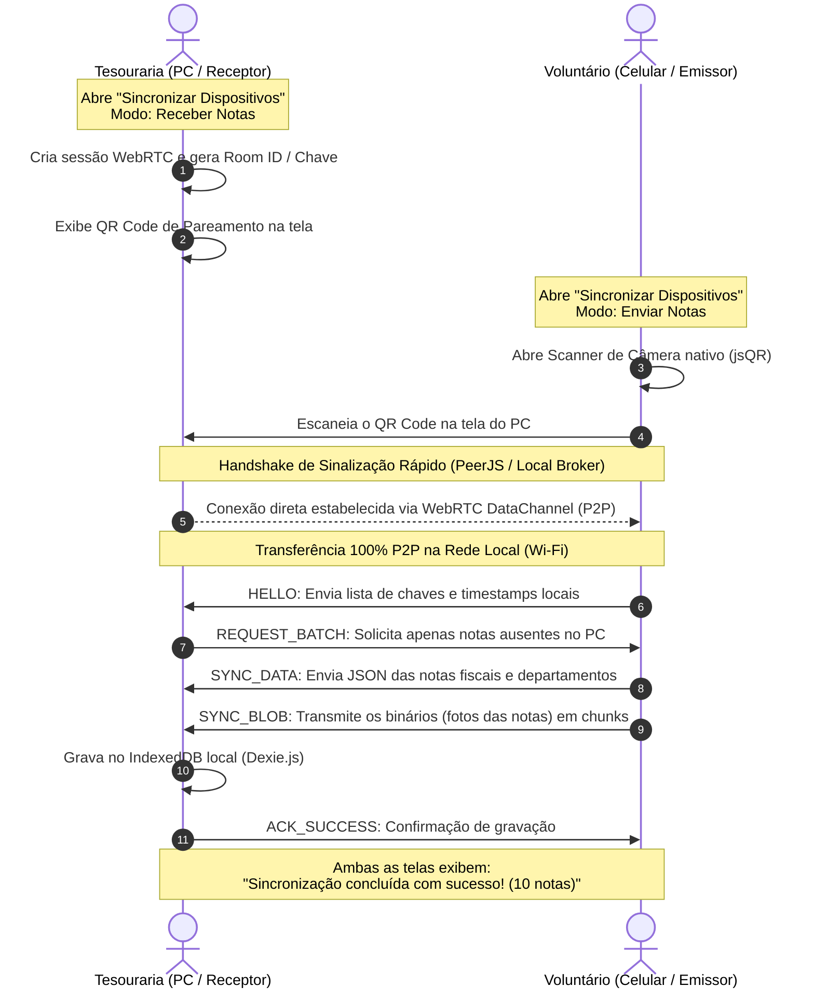

# 11 - Sincronização P2P em Rede Local com Pareamento por QR Code (Zero Backend)

Este plano detalha a especificação técnica e arquitetural para implementar a **sincronização descentralizada de notas fiscais entre dispositivos na mesma rede local (P2P)**, utilizando **WebRTC DataChannel**, pareamento visual via **QR Code** e **zero infraestrutura de backend**.

---

## 🎯 1. Contexto & Problema de Negócio

No fluxo operacional de uma igreja:
1. **Voluntários e líderes** compram materiais operacionais (combustível, materiais infantis, limpeza, instrumentos) e fotografam/escaneiam os cupons fiscais no próprio smartphone durante a semana.
2. **A tesouraria da igreja** centraliza a contabilidade em um computador de mesa ou notebook no escritório da igreja.
3. **Restrições de infraestrutura**: Muitas igrejas e congregações não possuem recursos para manter servidores cloud pagos (AWS, Supabase, Postgres dedicado), ou operam em áreas com conexão de internet instável, mas possuem uma rede Wi-Fi local no templo ou escritório.

### Solução Proposta:
Uma tecnologia de sincronização **Local-First / P2P**:
- O computador da tesouraria abre o Church Manager e clica em **"Receber Notas"** -> A aplicação gera e exibe um **QR Code de Pareamento** na tela.
- O celular do voluntário clica em **"Enviar Notas"** -> Abre a câmera e lê o QR Code na tela do computador.
- Instantaneamente, uma **conexão direta browser-to-browser (WebRTC DataChannel)** é aberta entre os dois aparelhos na rede local.
- Todas as notas fiscais, departamentos e **fotos binárias em alta resolução (`Blob`)** são transferidos em segundos na velocidade máxima do Wi-Fi local.
- Os dois aparelhos atualizam o status das notas para `SYNCED`.
- **Custo zero com nuvem, 100% privado, zero armazenamento de dados fiscais da igreja em servidores de terceiros.**

---

## 🏗️ 2. Arquitetura da Conexão P2P (WebRTC + QR Code)



---

## 🔌 3. Estratégia de Sinalização e Zero Backend

Para estabelecer uma conexão WebRTC entre dois navegadores, é necessário apenas trocar o handshake inicial (SDP Offer/Answer e candidatos ICE de rede local).

### Modelo Híbrido Resiliente:

1. **Canal Primário: Sinalização por Broker Efêmero Aberto (PeerJS Cloud / STUN público)**:
   - Utilização de serviço de sinalização efêmero gratuito e público (ex: rede PeerJS aberta).
   - O broker **só recebe o ID da sala e os endereços IP locais criptografados do handshake**.
   - **Nenhum dado fiscal, valor ou foto passa pelo broker**. 
   - Uma vez aberto o `RTCDataChannel`, a conexão é direta P2P entre os navegadores na rede Wi-Fi local.

2. **Canal Secundário: Local WebSocket / Endereço IP Local**:
   - Caso a rede esteja completamente isolada da internet (Air-Gapped LAN), o QR Code pode codificar o endereço IP/Porta local de um servidor WebSocket local (ex: `ws://192.168.1.100:8080`).

3. **Canal de Contingência: Troca de SDP via QR Code Bidirecional**:
   - O PC exibe o QR do Offer; o celular lê, gera o Answer e exibe o QR do Answer para o PC ler com a webcam.

---

## 📦 4. Protocolo de Sincronização de Dados (`SyncProtocol`)

### 4.1. Mensagens Trocadas via WebRTC DataChannel

```typescript
// src/domain/entities/p2p-sync.ts

export type P2PMessageType =
  | 'HELLO'
  | 'HELLO_ACK'
  | 'REQUEST_INVOICES'
  | 'INVOICE_DATA'
  | 'INVOICE_IMAGE_CHUNK'
  | 'DEPARTMENT_DATA'
  | 'SYNC_ACK'
  | 'SYNC_COMPLETE';

export interface P2PHelloMessage {
  type: 'HELLO';
  deviceName: string;
  invoicesSummary: Array<{
    accessKey: string;
    updatedAt: number;
    hasImage: boolean;
  }>;
}

export interface P2PRequestInvoicesMessage {
  type: 'REQUEST_INVOICES';
  neededAccessKeys: string[];
}

export interface P2PInvoiceDataMessage {
  type: 'INVOICE_DATA';
  invoice: Omit<Invoice, 'id' | 'imageBlob'>;
  hasImageBlob: boolean;
}

export interface P2PImageChunkMessage {
  type: 'INVOICE_IMAGE_CHUNK';
  accessKey: string;
  chunkIndex: number;
  totalChunks: number;
  data: string; // Base64 chunk ou ArrayBuffer
}

export interface P2PSyncAckMessage {
  type: 'SYNC_ACK';
  accessKey: string;
  success: boolean;
}
```

### 4.2. Fluxo de Transferência de Imagens Binárias
- Para garantir que fotos em alta definição (até 800 KB) não saturem o buffer do WebRTC:
  - O binário `Blob` é dividido em chunks de 64 KB (`RTCDataChannel.send()`).
  - O receptor remonta o `Blob` a partir dos chunks e armazena diretamente no Dexie.js como binário nativo, sem retenção em memória RAM.

---

## 🏛️ 5. Padrão Hexagonal & Portas do Sistema

### 5.1. Camada de Domínio (`src/domain/`)
- `src/domain/entities/p2p-sync.ts`: Tipos do protocolo, estados de conexão (`IDLE`, `GENERATING_QR`, `SCANNING`, `CONNECTING`, `TRANSFERRING`, `COMPLETED`, `FAILED`).
- `src/domain/services/sync-diff.service.ts`: Serviço puro que compara a lista de notas locais com a lista recebida no `HELLO` e determina quais notas precisam ser transmitidas (resolução Last-Write-Wins).

### 5.2. Camada de Portas (`src/ports/`)
- `src/ports/p2p-sync-adapter.port.ts`:
```typescript
export interface IP2PSyncAdapter {
  startHostSession(): Promise<{ sessionId: string; qrPayload: string }>;
  connectToHost(qrPayload: string): Promise<void>;
  sendInvoices(invoices: Invoice[]): Promise<void>;
  onProgress(callback: (progress: SyncProgress) => void): void;
  disconnect(): void;
}
```

### 5.3. Camada de Adaptadores (`src/adapters/`)
- `src/adapters/p2p/peerjs-sync.adapter.ts`: Implementação do adaptador com `peerjs`.
- `src/adapters/p2p/chunk-transfer.utils.ts`: Utilitário para fatiamento e remontagem de Blobs binários.

### 5.4. Camada de Estado & UI (`src/stores/` & `src/components/`)
- `src/stores/use-p2p-sync-store.ts`: Store Zustand que orquestra o estado da sincronização, progresso percentual, dispositivo conectado e logs de sincronização.
- `src/components/sync/p2p-sync-dialog.tsx`: Modal interativo:
  - Modo **"Receber Notas"**: Renderiza QR Code nítido na tela (usando `qrcode`), status de espera e lista de notas recebidas em tempo real.
  - Modo **"Enviar Notas"**: Exibe contador de notas pendentes (`3 notas pendentes de envio`), botão para abrir o scanner e barra de progresso de transmissão.
- `src/components/sync/sync-trigger-button.tsx`: Botão no Header e Dashboard com badge de notas pendentes (`PENDING_SYNC`).

---

## 🧪 6. Plano de Verificação e Testes

1. **Testes Unitários do Serviço de Diff (`tests/unit/sync-diff.test.ts`)**:
   - Comparação entre listas de notas:
     - Identificar notas ausentes no receptor.
     - Identificar notas atualizadas mais recentemente no emissor (LWW).
     - Ignorar notas que já estão idênticas em ambos os lados.
2. **Testes Unitários de Fatiamento e Montagem de Blobs (`tests/unit/chunk-transfer.test.ts`)**:
   - Fatiar um `Blob` de teste em múltiplos chunks e remontar garantindo integridade byte a byte (checksum / tamanho idêntico).
3. **Testes de Estado da Store (`tests/unit/p2p-sync-store.test.ts`)**:
   - Transições de estado da máquina: `IDLE` -> `WAITING_PEER` -> `TRANSFERRING` -> `COMPLETED`.
4. **Verificação Manual em Ambiente Real**:
   - Abrir a aplicação em dois navegadores distintos (ex: Chrome no Desktop e Safari/Chrome no celular na mesma rede Wi-Fi, ou duas abas anônimas com bancos isolados):
     1. Na Aba A (Receptor): Clicar em "Receber Notas" -> QR Code gerado na tela.
     2. Na Aba B (Emissor): Cadastrar 2 notas fiscais com fotos de comprovantes.
     3. Na Aba B: Clicar em "Enviar Notas" -> Escanear o QR Code da Aba A.
     4. Observar a transferência instantânea:
        - As 2 notas aparecem imediatamente no Dashboard da Aba A.
        - As fotos dos comprovantes abrem perfeitamente na visualização ampliada.
        - O status de sincronização muda de `PENDING_SYNC` para `SYNCED` em ambas as abas.

---

## 📅 7. Etapas de Execução

- **Etapa 1: Domínio & Protocolo de Mensagens**:
  - `p2p-sync.ts` e `sync-diff.service.ts` com testes unitários.
- **Etapa 2: Utilitários de Chunking de Blobs & Adaptador P2P**:
  - `chunk-transfer.utils.ts` e `peerjs-sync.adapter.ts`.
- **Etapa 3: Store Zustand (`useP2PSyncStore`)**:
  - Gerenciamento de ciclo de vida e integração com Dexie.js para gravação atômica em lote.
- **Etapa 4: Componentes de UI**:
  - Gerador de QR Code na tela (`QRCodeCanvas` / `qrcode`).
  - Modal `P2PSyncDialog` com modos Receber e Enviar.
  - Indicador e botão no Header (`SyncTriggerButton`).
